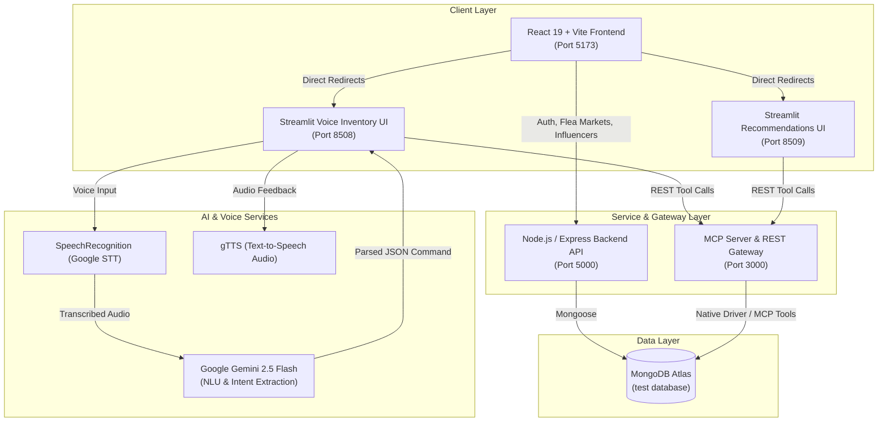

# LocalShop AI: Hyperlocal Commerce & Voice-Enabled Inventory Platform

[](https://nodejs.org/)
[](https://react.dev/)
[](https://streamlit.io/)
[](https://ai.google.dev/)
[](https://modelcontextprotocol.io/)
[](https://www.mongodb.com/)

A full-stack hyperlocal commerce and intelligent inventory management platform built for local shop owners and neighborhood consumers. **LocalShop AI** bridges traditional retail operations with modern AI automation—featuring voice-driven inventory updates powered by **Google Gemini**, **Model Context Protocol (MCP)** integration, smart product recommendations, local flea market discovery, and targeted influencer collaboration.

---

## Architecture Overview



---

## Key Features

### 1. Multi-Role Commerce Portal
- **Seller Dashboard**:
  - Centralized hub for managing local store operations and inventory.
  - Direct integration into AI-powered tools and market discovery pages.
- **Consumer Portal**:
  - Discover nearby local stores, view curated catalogs, and access smart recommendations.
- **Secure Authentication**:
  - Role-based registration and login for Sellers and Consumers with JWT authentication and bcrypt password hashing.

### 2. Voice-Powered AI Inventory Assistant (`inventory.py`)
- **Speech-to-Text with AI Enhancement**: Speak naturally into your microphone to update inventory (e.g., *"Add 50 packets of Milk price 60"* or *"Update price of Apple to 200"*).
- **Gemini 2.5 Flash Parsing**: AI translates unstructured spoken language into validated JSON schema commands (`ADD`, `UPDATE`, `DELETE`, `QUERY`).
- **Text-to-Speech Audio Feedback**: Receive spoken confirmation responses generated via Google Text-to-Speech (`gTTS`).
- **Live Inventory Dashboard**: Real-time table view of stock, prices, categories, and inventory value with instant search and manual CRUD capabilities.

### 3. Smart Recommendations Engine (`recomendations.py`)
- Personalized product recommendation scoring combining consumer purchase history, category preferences, and store popularity.
- Simulated purchase recording that automatically deducts inventory stock in MongoDB.
- Interactive buyer/seller analytics and audio summary generation.

### 4. Local Flea Market & Event Discovery
- Filter upcoming local markets, pop-up bazaars, and trade fairs by city, location name, event type, stall availability, and event dates.
- Paginated results with interactive event details and stall charge breakdowns.

### 5. Targeted Influencer Matchmaking
- Automatically matches store owners with relevant local influencers based on store category (Grocery, Clothing, Cafes, Hardware, etc.).
- Displays follower reach, engagement, categories, and direct contact details.

### 6. Model Context Protocol (MCP) Integration
- Implements standard MCP tools (`queryDocuments`, `addProduct`, `getInventory`, `updateProduct`, `deleteProduct`, `getPurchaseHistory`, `getRecommendations`).
- Includes a lightweight Express REST wrapper (`http://localhost:3000/tools/:toolName`) allowing standard web clients, Streamlit apps, and external LLM agents to execute database tasks safely.

---

## Tech Stack

| Domain | Technology |
|---|---|
| **Frontend** | React 19, Vite, React Router v7, Bootstrap 5, Tailwind CSS utilities, Axios, React Icons |
| **Backend API** | Node.js (ES Modules), Express 5, Mongoose, JSON Web Tokens (JWT), bcryptjs, CORS |
| **MCP & Database** | `@modelcontextprotocol/sdk`, MongoDB Node Driver 6.x, MongoDB Atlas |
| **AI & Voice** | Google Gemini 2.5 Flash (`google-generativeai`), `speech_recognition`, `gTTS`, `pyaudio` |
| **Data UIs** | Streamlit, Python 3.9+, Requests, python-dotenv |
| **Orchestration** | Bash (`run-all.sh`) with multi-process management and trap handlers |

---

## Repository Structure

```text
.
├── README.md                      # Project documentation
├── run-all.sh                     # Orchestration script to run all 5 services concurrently
└── mongo-mcp/
    ├── local-shop-app/
    │   ├── backend/               # Express REST API
    │   │   ├── src/
    │   │   │   ├── config/        # MongoDB connection setup
    │   │   │   ├── models/        # Mongoose models (Seller, Consumer, FleaMarket, Influencer)
    │   │   │   └── routes/        # API route handlers
    │   │   ├── seed_db.js         # Seed script for flea market events
    │   │   ├── server.js          # Backend server entry point (port 5000)
    │   │   └── package.json
    │   │
    │   └── frontend/              # React 19 + Vite web application
    │       ├── src/
    │       │   ├── pages/
    │       │   │   ├── auth/      # RoleSelection, SellerLogin, ConsumerLogin
    │       │   │   ├── seller/    # SellerDashboard, FleaMarkets, InfluencerCollab, etc.
    │       │   │   └── consumer/  # ConsumerDashboard
    │       │   ├── App.jsx        # App router and protected route guards
    │       │   └── main.jsx
    │       ├── vite.config.js
    │       └── package.json
    │
    ├── mcp-server/                # Model Context Protocol Server + REST Adapter
    │   ├── server.js              # MCP Server tools & Express HTTP gateway (port 3000)
    │   ├── mcp.json               # MCP tool schemas
    │   ├── setup_seller.js        # Seed default seller account
    │   ├── test_recommendations.js# Test script for recommendation queries
    │   └── package.json
    │
    └── streamlit-ui/              # AI & Voice Streamlit applications
        ├── inventory.py           # Voice-controlled inventory management (port 8508)
        ├── recomendations.py      # Recommendations and shopping simulator (port 8509)
        ├── app.py                 # Natural-language MongoDB admin panel
        ├── audio_files/           # Temporary TTS audio response cache
        └── requirements.txt       # Python dependencies
```

---

## Prerequisites

Before starting, ensure you have the following installed on your machine:

1. **Node.js**: Version 18.x or later (`node -v`)
2. **Python**: Version 3.9 or later (`python3 --version`)
3. **MongoDB**: Access to a MongoDB Atlas cluster or a local MongoDB database instance
4. **Google Gemini API Key**: Obtain a key from [Google AI Studio](https://aistudio.google.com/)
5. **System Audio Support (for Voice features)**:
   - **macOS**: Microphone permissions granted in System Settings. Install `portaudio` via Homebrew if building PyAudio from source:
     ```bash
     brew install portaudio
     ```
   - **Linux (Ubuntu/Debian)**:
     ```bash
     sudo apt-get install python3-pyaudio portaudio19-dev
     ```

---

## Environment Setup

Create `.env` files in each sub-project directory:

### 1. Backend (`mongo-mcp/local-shop-app/backend/.env`)
```env
PORT=5000
MONGO_URI=your_mongodb_connection_string
JWT_SECRET=your_jwt_secret_key
```

### 2. MCP Server (`mongo-mcp/mcp-server/.env`)
```env
PORT=3000
MONGO_URI=your_mongodb_connection_string
MONGO_DB=test
```

### 3. Streamlit UI (`mongo-mcp/streamlit-ui/.env`)
```env
MCP_SERVER=http://localhost:3000
GEMINI_API_KEY=your_google_gemini_api_key
```

---

## Quick Start (One-Command Startup)

The repository provides a unified script `run-all.sh` that spins up all services simultaneously.

### Step 1: Install Dependencies

#### Install Node dependencies:
```bash
# Backend dependencies
cd "mongo-mcp/local-shop-app/backend" && npm install

# Frontend dependencies
cd "../frontend" && npm install

# MCP Server dependencies
cd "../../mcp-server" && npm install

cd ../..
```

#### Set up the Python Virtual Environment for Streamlit:
```bash
cd "mongo-mcp/streamlit-ui"
python3 -m venv .venv
source .venv/bin/activate
pip install -r requirements.txt
cd ../..
```

### Step 2: Seed Initial Data (Optional)

```bash
# Seed default seller account ('aa' / '111111')
cd "mongo-mcp/mcp-server" && node setup_seller.js

# Seed flea market events
cd "../local-shop-app/backend" && node seed_db.js

cd ../..
```

### Step 3: Launch All Services

From the project root directory, run:

```bash
chmod +x run-all.sh
./run-all.sh
```

### Service Endpoints

| Service | Port | Local URL |
|---|---|---|
| **React Web Frontend** | `5173` | [http://localhost:5173](http://localhost:5173) |
| **Backend Express API** | `5000` | [http://localhost:5000](http://localhost:5000) |
| **MCP REST Server** | `3000` | [http://localhost:3000](http://localhost:3000) |
| **Streamlit Inventory UI (Voice)** | `8508` | [http://localhost:8508](http://localhost:8508) |
| **Streamlit Recommendations UI** | `8509` | [http://localhost:8509](http://localhost:8509) |

> **Tip:** Press `Ctrl + C` in your terminal to safely stop all running processes at once.

---

## Running Services Individually

If you prefer to run or debug services in individual terminal tabs:

### 1. Backend REST API
```bash
cd mongo-mcp/local-shop-app/backend
npm run dev
# Running on http://localhost:5000
```

### 2. MCP Server
```bash
cd mongo-mcp/mcp-server
npm run start
# Running on http://localhost:3000
```

### 3. React Frontend
```bash
cd mongo-mcp/local-shop-app/frontend
npm run dev
# Running on http://localhost:5173
```

### 4. Streamlit Voice Inventory Management
```bash
cd mongo-mcp/streamlit-ui
source .venv/bin/activate
streamlit run inventory.py --server.port 8508
```

### 5. Streamlit AI Recommendations
```bash
cd mongo-mcp/streamlit-ui
source .venv/bin/activate
streamlit run recomendations.py --server.port 8509
```

---

## API & MCP Tool Reference

### Backend Endpoints (`http://localhost:5000`)
- `POST /api/seller/register`: Register new seller with business category and location.
- `POST /api/seller/login`: Authenticate seller and receive JWT.
- `POST /api/consumer/register`: Register new consumer.
- `POST /api/consumer/login`: Authenticate consumer and receive JWT.
- `GET /api/flea-markets`: Query flea markets with filters (`event_type`, `event_city`, `event_location`, `stall_availability`, `page`, `limit`).
- `GET /api/influencer/:category`: Fetch influencers matched to a specific store category.

### MCP Tools (`http://localhost:3000/tools/<toolName>`)
- `addProduct`: Add a new product to a seller's catalog (`{ username, product: { productName, price, stock, category } }`).
- `getInventory`: Fetch all inventory items belonging to a seller (`{ username }`).
- `updateProduct`: Modify product fields by `productId` (`{ productId, updates }`).
- `deleteProduct`: Delete a product by `productId` (`{ productId }`).
- `recordPurchase`: Log consumer purchase and decrement inventory stock (`{ username, productId, productName, category, seller, price }`).
- `getPurchaseHistory`: Retrieve past purchases for a consumer.
- `getRecommendations`: Compute personalized product recommendations for a user.
- `queryDocuments`: Direct document query tool with custom filters.

---

## Troubleshooting

- **Microphone / Voice input does not record:**
  Ensure your terminal and browser have microphone access permissions enabled in your operating system settings. On macOS, go to **System Settings > Privacy & Security > Microphone**.
- **PyAudio installation errors:**
  Ensure PortAudio is installed first (`brew install portaudio` on macOS) before installing `pyaudio`.
- **Streamlit module not found:**
  Ensure the virtual environment is activated (`source .venv/bin/activate`) or set `PYTHON_BIN` in `run-all.sh` to your active Python executable.
- **Port already in use:**
  If a port (e.g. `5000` or `3000`) is occupied, identify and kill the process:
  ```bash
  lsof -ti:5000 | xargs kill -9
  ```

---

## License

This project is licensed under the ISC License.
